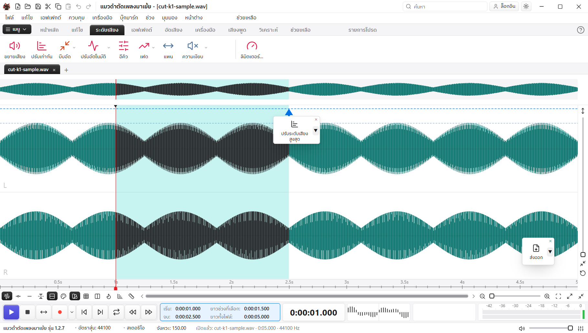
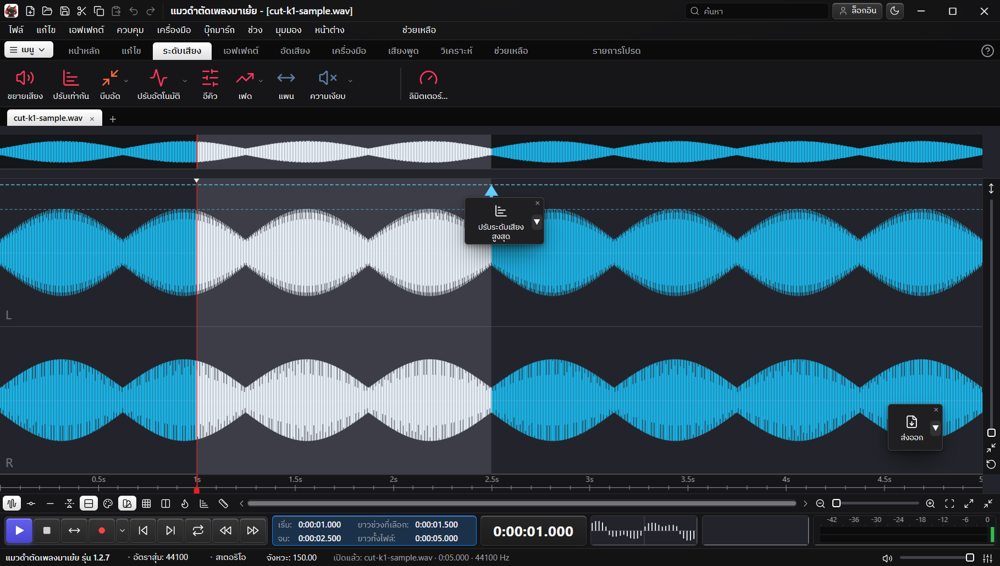
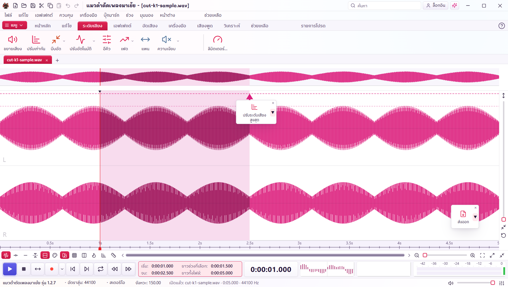
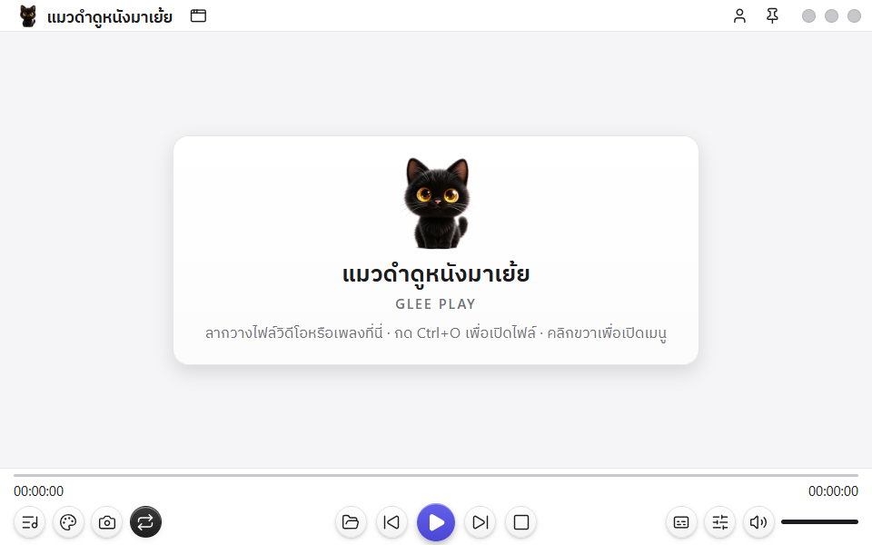
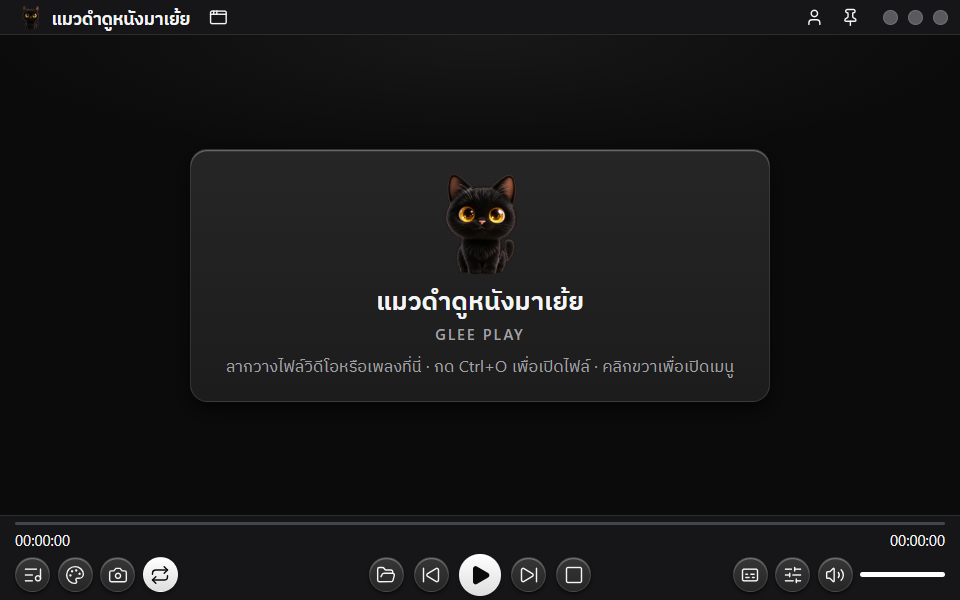
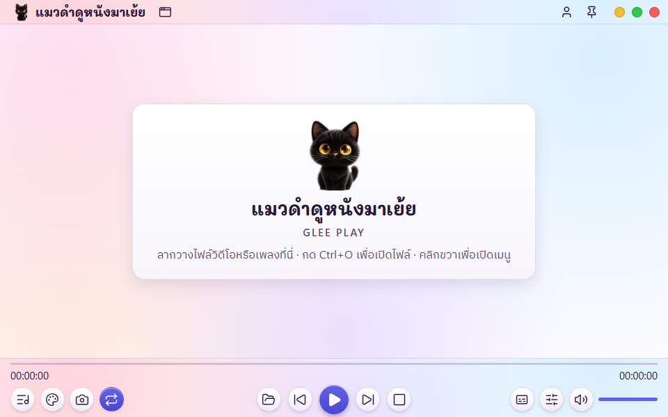
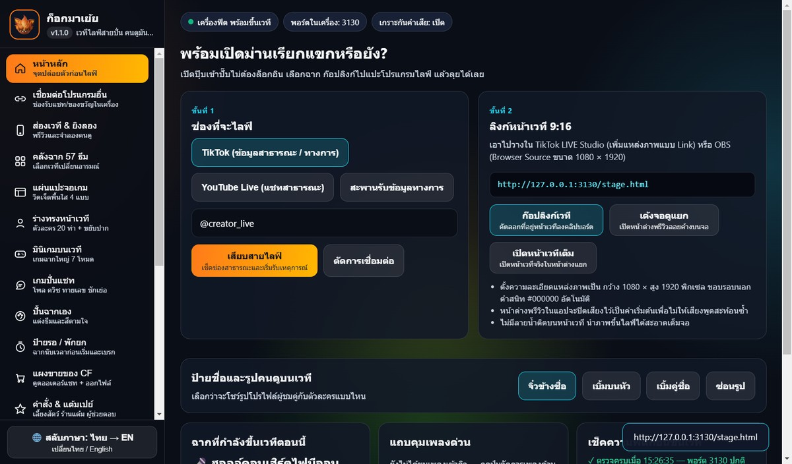
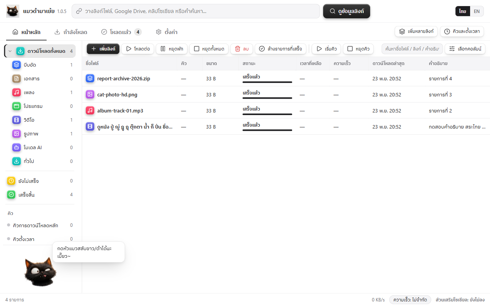

# ศูนย์ดาวน์โหลดโปรแกรม GLee · GLee Apps Download Center

**โปรแกรมใช้งานฟรี ทำงานในเครื่องเป็นหลัก ไม่มีโฆษณา**  
**Free, offline-first desktop apps for Windows. No ads.**

[ข้อตกลงการใช้งาน (Terms)](TERMS.md) · [ความเป็นส่วนตัว (Privacy)](PRIVACY.md) · [เครดิตชิ้นส่วน (Credits)](CREDITS.md) · [หน้าดาวน์โหลด (Releases)](https://github.com/G-Lee21/glee-download/releases)

---

## รายชื่อโปรแกรม · Applications

<table>
  <tr>
    <td width="104" align="center" valign="top">
      
    </td>
    <td valign="top">
      <h3>แมวดำตัดเพลงมาเย้ย (GLee Cut)</h3>
      

        โปรแกรมตัดต่อ แต่งเสียง และแปลงไฟล์เสียงบน Windows 3 ธีมมาตรฐาน (ขาว · ดำ · สีรุ่ง) ใช้งานได้ครบแบบไม่ต้องต่อเน็ต ไฟล์เสียงอยู่ในเครื่องคุณ 100% 
        <em>Offline-first Windows audio editor, effects suite, and batch converter with 3 clean themes (White · Black · Candy). Your audio files stay 100% on your PC.</em>
      

      

        
        &nbsp;<strong>โปรแกรม 1.2.7</strong>
        &nbsp;<code>Windows 10 / 11 (64-bit)</code>
        &nbsp;·&nbsp;<code>6.32 MB</code>
      

      

        <a href="https://github.com/G-Lee21/glee-download/releases/tag/cut-v1.2.7">รายละเอียดรุ่น · Release notes</a>
        &nbsp;·&nbsp;SHA-256: <code>ce840773f34df0d008967ecc6de396a627f4c44d9ef8204bd2bce744d140bb33</code>
      

      

        
<strong>ภาพหน้าจอ · Screenshots (3 ธีม: ขาว · ดำ · สีรุ่ง)</strong>

         
        
<strong>ธีมขาว (White — ค่าเริ่มต้น)</strong>

        
        
<strong>ธีมดำ (Black) · ธีมสีรุ่ง (Candy)</strong>

        
&nbsp;&nbsp;

      

    </td>
  </tr>
  <tr>
    <td width="104" align="center" valign="top">
      
    </td>
    <td valign="top">
      <h3>แมวดำดูหนังมาเย้ย (GLee Play)</h3>
      

        โปรแกรมเล่นวิดีโอและเพลงบน Windows รองรับไฟล์หลากสกุล 3 ธีมมาตรฐาน (ขาว / ดำ / สีรุ้ง) สีปุ่มตามธีม จับภาพทันที เล่นวนเป็นค่าเริ่มต้น อัปเดตในโปรแกรมได้ ปรับภาพ เสียง และซับไตเติลได้ครบ 
        <em>Fast Windows video and music player with wide format support, 3 clean themes (White / Black / Candy) with theme-matched controls, instant capture, default repeat playback, built-in auto-updates, and full subtitle/audio controls.</em>
      

      

        
        &nbsp;<strong>โปรแกรม 1.1.7</strong>
        &nbsp;<code>Windows 10 / 11 (64-bit)</code>
        &nbsp;·&nbsp;<code>59.67 MB</code>
      

      

        <a href="https://github.com/G-Lee21/glee-download/releases/tag/play-v1.1.7">รายละเอียดรุ่น · Release notes</a>
        &nbsp;·&nbsp;SHA-256: <code>32ac6fb8e3fd296b124f63cd455fcb77d0c95460fdac6ebde4fd382c3c40502b</code>
      

      

        ต้องมี .NET 10 Desktop Runtime (x64) ในเครื่อง ถ้ายังไม่มี ตัวติดตั้งจะโหลดจาก Microsoft และลงให้อัตโนมัติ (ต้องต่อเน็ต และกดยืนยัน 1 ครั้ง)
      

      

        ผู้ที่ลงรุ่นก่อน 1.0.12 ให้โหลดลงทับ 1 ครั้ง ต่อจากนั้นอัปเดตในโปรแกรมได้ 
        <em>Users on versions earlier than 1.0.12: download and install once to enable in-app auto-updates.</em>
      

      

        
<strong>ภาพหน้าจอ · Screenshots (3 ธีม: ขาวเรียบหรู · ดำเรียบหรู · สีรุ้งลูกกวาด)</strong>

         
        
<strong>ธีมขาวเรียบหรู (White — ค่าเริ่มต้น)</strong>

        
        
<strong>ธีมดำเรียบหรู (Black) · ธีมสีรุ้งลูกกวาด (Candy)</strong>

        
&nbsp;&nbsp;

      

    </td>
  </tr>
  <tr>
    <td width="104" align="center" valign="top">
      
    </td>
    <td valign="top">
      <h3>ก็อกมาเย้ย (GLee GOK Live)</h3>
      

        เวทีไลฟ์โต้ตอบพร้อมฉาก 57 ธีม มินิเกมให้คนดูเล่นผ่านแชท ห้องควบคุมไลฟ์ และดนตรีสังเคราะห์ ใช้คู่กับ OBS หรือ TikTok LIVE Studio 
        <em>Interactive live-stream stage with 57 themes, chat mini-games, live control room, and built-in synth music for OBS / TikTok LIVE Studio.</em>
      

      

        
        &nbsp;<code>Windows 10 / 11 (64-bit)</code>
      

      

        
<strong>ภาพหน้าจอ · Screenshot</strong>

         
        
      

    </td>
  </tr>
  <tr>
    <td width="104" align="center" valign="top">
      
    </td>
    <td valign="top">
      <h3>แมวดำมาเย้ย (GLee Load)</h3>
      

        โปรแกรมช่วยดาวน์โหลดไฟล์และคลิปโซเชียลความเร็วสูงบน Windows แบ่งหลายท่อน หยุดแล้วโหลดต่อ จัดคิว ตั้งเวลา จำกัดความเร็ว รองรับไฟล์ใหญ่จาก Google Drive รวมตัวดึงคลิป ตัวรวมภาพกับเสียง (FFmpeg รุ่น LGPL) ตัดช่วง เครื่องเล่นในตัว และส่วนขยาย Chrome / Edge (<strong>ส่วนขยาย 1.1.8</strong>) ในตัวติดตั้งเดียวที่ <a href="https://github.com/G-Lee21/glee-download-extra/releases/tag/load-v1.1.8">glee-download-extra</a> 
        <em>Fast Windows multi-part download manager and media saver with pause/resume, queues, scheduler, speed limiter, Google Drive large-file support, bundled LGPL media tools, built-in media player, and Chrome / Edge <strong>Extension 1.1.8</strong> — distributed as a unified installer via <a href="https://github.com/G-Lee21/glee-download-extra/releases/tag/load-v1.1.8">glee-download-extra</a>.</em>
      

      

        
        &nbsp;<strong>โปรแกรม 1.1.8 · ส่วนขยาย 1.1.8</strong>
        &nbsp;<code>Windows 10 / 11 (64-bit)</code>
        &nbsp;·&nbsp;<code>76.47 MB</code>
      

      

        <a href="https://github.com/G-Lee21/glee-download-extra/releases/tag/load-v1.1.8">รายละเอียด โปรแกรม 1.1.8 · ส่วนขยาย 1.1.8</a>
        &nbsp;·&nbsp;<a href="https://github.com/G-Lee21/glee-download-extra/releases/tag/load-v1.1.4">รุ่นก่อนหน้า: โปรแกรม 1.1.4 · ส่วนขยาย 1.1.4</a>
        &nbsp;·&nbsp;SHA-256: <code>5ba39cda54cce778abfa11d85a79ac88dc6869227d0d74f041d62d8158d01255</code>
      

      

        
<strong>ภาพหน้าจอ · Screenshot</strong>

         
        
      

    </td>
  </tr>
</table>

> **หมายเหตุ / Note:** โปรแกรมที่มีปุ่มดาวน์โหลดพร้อมใช้งานแล้วในหน้า [Releases](https://github.com/G-Lee21/glee-download/releases) · โปรแกรมที่ขึ้นป้าย "เร็วๆ นี้" กำลังทยอยเผยแพร่ · Apps with a Download button are available now on [Releases](https://github.com/G-Lee21/glee-download/releases); others are coming soon.

---

## เครื่องที่ใช้ได้ · System Requirements

| รายการ · Item | รายละเอียด · Details |
|---|---|
| **ระบบปฏิบัติการ / OS** | Windows 10 หรือ Windows 11 รุ่น 64-bit (`x86_64`) |
| **ส่วนเสริมที่จำเป็น / Runtime** | GLee Cut และ GLee Play ใช้ **Microsoft Edge WebView2** (มีมาพร้อม Windows 11 อยู่แล้ว และตัวติดตั้งจะช่วยติดตั้งให้อัตโนมัติหากเครื่องยังไม่มี) · *GLee Cut & GLee Play use Microsoft Edge WebView2 (pre-installed on Windows 11; automatically handled by the installer if missing).* |
| **การใช้งานออฟไลน์ / Offline** | ใช้งานฟีเจอร์หลักในเครื่องได้โดยไม่ต้องต่ออินเทอร์เน็ตและไม่ต้องล็อกอิน · *Core features work offline without signing in.* |

---

## วิธีติดตั้ง · How to Install

### แบบติดตั้งถาวร (`*-Setup.exe`) · Standard Installer
1. ดาวน์โหลดไฟล์ `GLee-*-Setup.exe` จากหน้า [Releases](https://github.com/G-Lee21/glee-download/releases)
2. ดับเบิลคลิกไฟล์เพื่อเปิดหน้าตัวติดตั้งมาตรฐาน GLee แล้วกด **"ติดตั้ง" (Install)** *(กด "เปลี่ยนที่ติดตั้ง" ได้หากต้องการเลือกแฟ้มเอง)*
3. หาก Windows แสดงหน้าต่างเตือนสีน้ำเงิน **Windows protected your PC (SmartScreen)** เนื่องจากเป็นโปรแกรมแจกฟรีที่ไม่มีใบรับรองแบบเสียเงิน ให้ทำตามนี้:
   - **ภาษาไทย:** กดคำว่า **"ข้อมูลเพิ่มเติม"** → แล้วกดปุ่ม **"เรียกใช้ต่อไป"**
   - **English:** Click **"More info"** → then click **"Run anyway"**
4. รอแถบความคืบหน้าครบ 100% แล้วกด **"เปิดเลย" (Launch)**

### แบบพกพา (`*-Portable.zip`) · Portable Edition
1. ดาวน์โหลดไฟล์ `GLee-*-Portable.zip` จากหน้า [Releases](https://github.com/G-Lee21/glee-download/releases)
2. แตกไฟล์ (Extract All) ลงในแฟ้มที่ต้องการ แล้วเปิดไฟล์ `.exe` ของโปรแกรมได้ทันทีโดยไม่ต้องติดตั้ง

### ส่วนขยาย Chrome / Edge ของแมวดำมาเย้ย (GLee Load — โปรแกรม 1.0.8 · ส่วนขยาย 1.0.8) · Browser Extension Setup
ส่วนขยายมาพร้อมกับตัวติดตั้ง `GLee-Load-1.0.8-Setup.exe` อยู่แล้ว — เปิดแท็บ **ตั้งนิสัยแมว** ในแมวดำมาเย้ย แล้วกดปุ่ม **"พกแมวขึ้น Chrome / Edge"** เพื่อเปิดแฟ้มที่ติดตั้งพร้อมไฮไลต์แฟ้ม `ส่วนขยาย Chrome แมวดำมาเย้ย` (หรือคัดลอกที่อยู่เต็มจากหน้าตั้งนิสัยแมว) จากนั้นทำตาม 3 ขั้นตอน:
1. เปิด `chrome://extensions` (หรือ `edge://extensions`) แล้วเปิด **"โหมดนักพัฒนาซอฟต์แวร์" (Developer mode)**
2. กด **"โหลดส่วนขยายที่แตกไฟล์แล้ว" (Load unpacked)** แล้วเลือกแฟ้ม `ส่วนขยาย Chrome แมวดำมาเย้ย` ที่ไฮไลต์ไว้ *(หากเคยลงรุ่นก่อนเช่น ส่วนขยาย 2.0.7 หรือ ส่วนขยาย 1.2.6 ให้กดปุ่มรีโหลด ⟳ บนการ์ดส่วนขยายเพื่ออัปเดตเป็น ส่วนขยาย 1.0.8)*
3. ใช้งานได้ทันที *(กด `Alt` ค้างตอนคลิกลิงก์หากต้องการให้เบราว์เซอร์โหลดเอง และไฟล์เล็กกว่า 1 MB จะปล่อยให้เบราว์เซอร์โหลดอัตโนมัติ)*

---

## วิธีอัปเดต · How to Update

- **แบบติดตั้งถาวร (Installer):** เมื่อมีรุ่นใหม่ โปรแกรมจะแจ้งเตือนอัตโนมัติในหน้าต่างโปรแกรม (เช็กรุ่นใหม่จาก GitHub วันละไม่เกิน 1 ครั้ง) กด **"อัปเดตเลย" (Update now)** โปรแกรมจะตรวจสอบความถูกต้องของไฟล์ด้วย SHA-256 และลายเซ็นดิจิทัล แล้วติดตั้งทับที่เดิมโดย **ข้อมูลและการตั้งค่าเดิมอยู่ครบทั้งหมด** *(หรือกดปุ่ม "ตรวจหาอัปเดต" ในหน้าเกี่ยวกับแอปได้ทุกเมื่อ)*
- **แบบพกพา (Portable):** โปรแกรมจะแจ้งเมื่อมีรุ่นใหม่เช่นกัน ให้ดาวน์โหลดไฟล์ `.zip` รุ่นใหม่จากหน้า [Releases](https://github.com/G-Lee21/glee-download/releases) มาใช้งานแทน

---

## วิธีถอนการติดตั้ง · How to Uninstall

- **แบบติดตั้งถาวร (Installer):**
  1. เปิด **การตั้งค่า (Settings)** → **แอป (Apps)** → **แอปที่ติดตั้ง (Installed apps)**
  2. ค้นหาชื่อโปรแกรมที่ต้องการถอน แล้วกด **ถอนการติดตั้ง (Uninstall)**
  3. หน้าตัวถอนการติดตั้งของ GLee จะมีช่อง **"เก็บข้อมูลและการตั้งค่าไว้" (Keep my data and settings)** ติ๊กไว้เป็นค่าเริ่มต้น หากต้องการลบข้อมูลการตั้งค่าของโปรแกรมนี้ในเครื่องออกด้วย ให้เอาเครื่องหมายติ๊กออกก่อนกด **"ถอนการติดตั้ง"**
- **แบบพกพา (Portable):** ปิดโปรแกรมแล้วลบแฟ้มที่แตกไฟล์ไว้ได้เลย

---

## เอกสารเพิ่มเติม · Documentation

- [ข้อตกลงการใช้งาน · Terms of Use](TERMS.md)
- [นโยบายความเป็นส่วนตัว · Privacy Policy](PRIVACY.md)
- [เครดิตชิ้นส่วนและใบอนุญาต · Third-Party Credits & Licenses](CREDITS.md)
